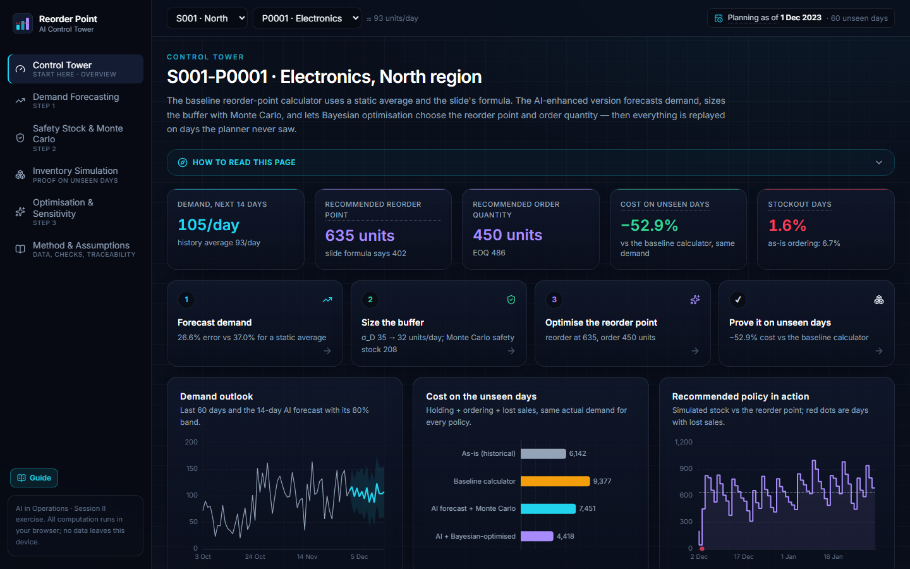
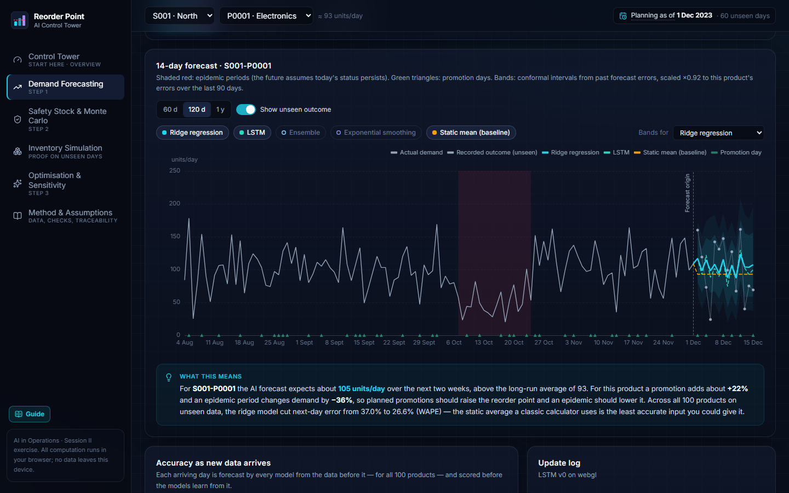
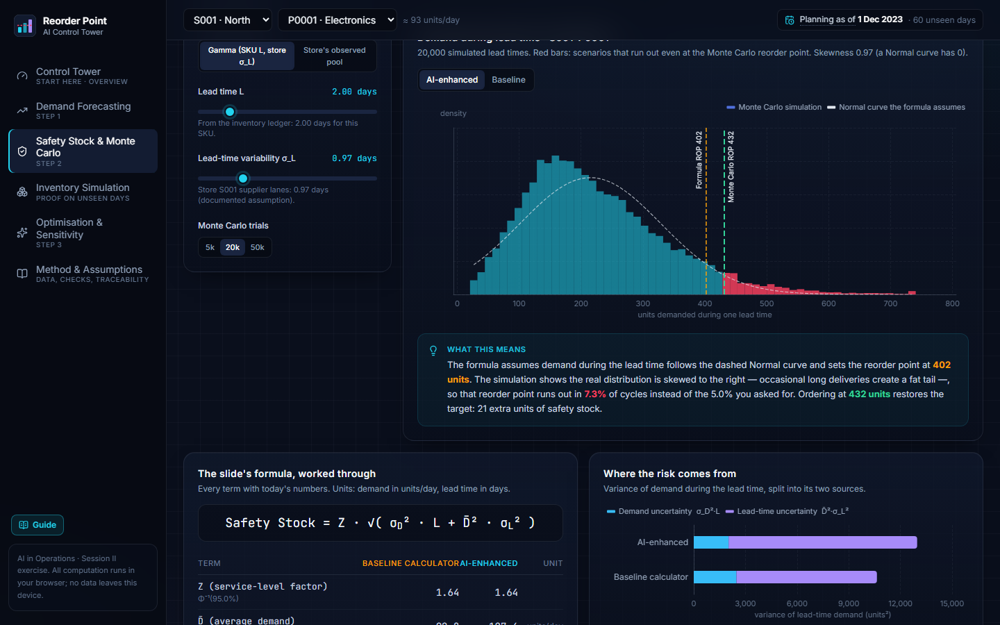
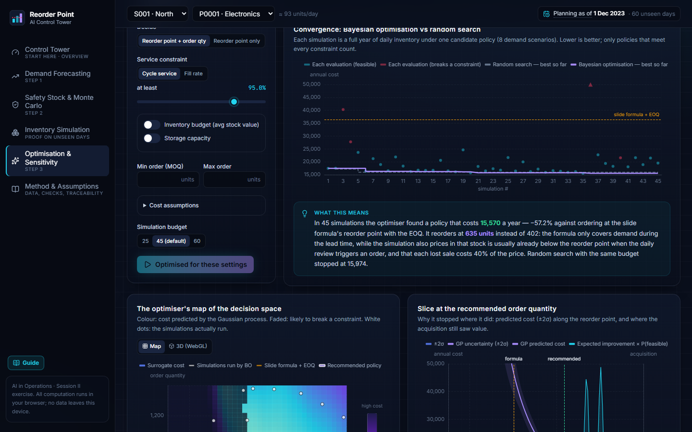
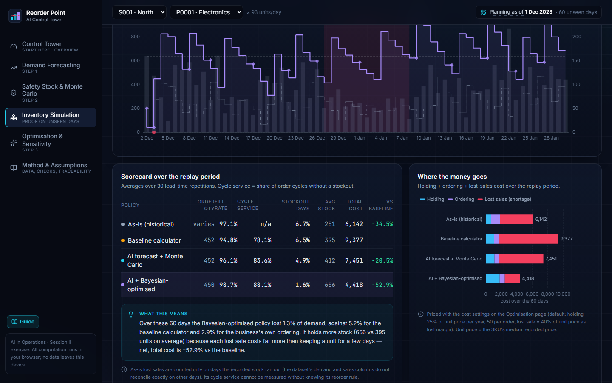
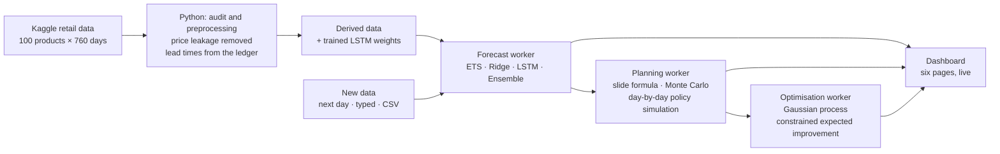

<div align="center">

# AI-Enhanced Reorder Point & Inventory Management

**When should a store reorder, how much, and how much safety stock does it need?**<br/>
A classic reorder-point calculator, upgraded with machine-learning forecasts, Monte Carlo safety stock and Bayesian optimisation,<br/>
and tested on 60 days of data the planner never saw.

[](https://ai-reorder-point-dashboard.netlify.app)


*AI in Operations (Term 4) · Session II exercise: "AI Applications in Reorder Point & Inventory Management"*

<a href="https://ai-reorder-point-dashboard.netlify.app"></a>

</div>

> **Opening the dashboard for the first time?** Use the **Start here** card or the **Guide** button. It has a 5-minute walkthrough, shows where each part of the exercise is answered, and explains every term. Each page also opens with a short "How to read this page", and dotted-underlined words show their definition when you hover over or tap them.

---

## The exercise and where it is answered

| # | The slide asks for | What was built | Page |
|:-:|---|---|---|
| **1** | **Demand forecasting:** ML models (time series, regression, LSTM), the possibility of adding new data, continuously updated forecasts | Exponential smoothing, ridge regression and an LSTM, plus an ensemble, with prediction bands. New days can be streamed, typed in or uploaded as CSV; each new day is scored before the models learn from it, and the LSTM is fine-tuned in the browser. | [Demand Forecasting](https://ai-reorder-point-dashboard.netlify.app/forecasting) |
| **2** | **Dynamic safety stock:** probabilistic models and Monte Carlo with `SS = Z·√(σ_D²·L + D̄²·σ_L²)` | The slide's formula worked through term by term, with demand and errors from the forecast and lead times measured from the inventory ledger. 20,000 Monte Carlo lead-time scenarios check it. | [Safety Stock & Monte Carlo](https://ai-reorder-point-dashboard.netlify.app/safety-stock) |
| **3** | **AI-driven sensitivity analysis:** Bayesian optimisation for optimal reorder points under constraints | A Gaussian-process model with constrained expected improvement chooses the reorder point and order quantity under service, budget, capacity and order-size limits. It also shows a cost map, a 3D surface, tornado charts and a price-of-service curve. | [Optimisation & Sensitivity](https://ai-reorder-point-dashboard.netlify.app/optimization) |
| ✓ | Proof | Every policy is replayed day by day on the 60 unseen days, using the demand that actually happened. | [Inventory Simulation](https://ai-reorder-point-dashboard.netlify.app/simulation) |

## Key results

Measured on **100 products × 60 days that no model or optimiser ever saw** (2 Dec 2023 – 30 Jan 2024), with a 95% service target:

| | Classic calculator | AI-enhanced |
|---|---|---|
| **Forecast error** (next-day WAPE) | 37.0% (static average) | **26.6%** (ridge regression; Diebold–Mariano p < 0.001) |
| **Stockout risk at the formula's reorder point** | Target 5% | Actually **9.5%**: Monte Carlo shows lead-time demand is right-skewed, so the Normal formula under-protects |
| **Cycle service achieved** | 76.9% | **90–93%** with Bayesian-optimised policies |
| **Total cost** (holding + ordering + lost sales) | 845,065 | **438,541 – 484,340 (−43% to −48%)** |
| **Effort to find the best policy** | 900-simulation grid search | **45 simulations** (5% of the effort); median gap to the grid's best 0.0% |

What the numbers say: a better forecast alone cuts cost by about 7%. The large gain comes from letting Bayesian optimisation choose the policy against the true cost of running out, instead of a formula with a fixed Z-score. The full comparison of all eight policies is in [docs/results/holdout_replay.md](docs/results/holdout_replay.md).

## A look inside

<table>
  <tr>
    <td width="50%"><br/><b>Step 1 · Demand forecasting.</b> Three model families compared against the static average, with the unseen outcome overlaid.</td>
    <td width="50%"><br/><b>Step 2 · Safety stock.</b> 20,000 simulated lead times show where the Normal formula's tail falls short.</td>
  </tr>
  <tr>
    <td width="50%"><br/><b>Step 3 · Bayesian optimisation.</b> Each dot is a full year of simulated inventory; BO converges far faster than random search.</td>
    <td width="50%"><br/><b>Proof · Inventory simulation.</b> The recommended policy replayed day by day on the 60 unseen days.</td>
  </tr>
  <tr>
    <td colspan="2" align="center"><br/><b>Built-in guide.</b> A walkthrough, a map from the slide to the dashboard, and a glossary for first-time viewers.</td>
  </tr>
</table>

## How it works



- **Honest evaluation.** Data is split into training (to 2 Sep 2023), validation (to 1 Dec 2023) and a 60-day holdout. The dashboard plans as of 1 Dec 2023, so nothing it recommends has seen the days it is tested on.
- **No leakage.** The data audit found that the price columns are computed from same-day demand, so they are excluded from every model.
- **Everything is computed live.** The models, simulations and optimiser run in Web Workers in the visitor's browser, so nothing is pre-drawn and the page stays responsive while they run.
- **The browser matches Python.** The TypeScript models agree with scikit-learn, statsmodels and Keras to within 1e-5 or better, and every reported number is reproducible.

Details: [design and architecture](docs/IMPLEMENTATION_PLAN.md) · [numerical verification](docs/VERIFICATION.md) · [test report](docs/TEST_REPORT.md).

## Built with

| Area | Tools |
|---|---|
| Analysis and model training | Python, pandas, statsmodels, scikit-learn, TensorFlow/Keras (in [Jupyter notebooks](notebooks/)) |
| Models in the browser | TypeScript implementations of ETS, ridge regression, Gaussian processes and Monte Carlo; TensorFlow.js for the LSTM |
| Interface | React 19, Vite, Tailwind CSS, ECharts (incl. WebGL 3D), Motion |
| Quality | Vitest (116 unit and parity tests), Playwright (15 browser tests, also run against the live site), Lighthouse 96–100 |
| Hosting | Netlify, with a strict Content-Security-Policy and security headers |

## Verification at a glance

- **Requirements:** every slide requirement is mapped to the tests that prove it ([TEST_REPORT.md](docs/TEST_REPORT.md)).
- **Maths:** the slide-formula examples are reproduced by hand, and Monte Carlo matches theory and NumPy to within 1% ([VERIFICATION.md](docs/VERIFICATION.md)).
- **Optimiser:** benchmarked on the Branin function and against a 900-point grid search.
- **Live site:** the full browser test suite passes against the deployed dashboard; the console is clean, nothing overflows at phone width, and it works under the production security policy.

## Repository layout

```
notebooks/    01_data_audit.ipynb, 02_reference_models_and_lstm.ipynb   (executed, outputs included)
scripts/      data loading, Python reference models, preprocessing, test fixtures
dashboard/    the web app (React + TypeScript)
  src/lib/        forecasting, inventory (formula, Monte Carlo, simulation), optimisation (GP, Bayesian opt.)
  src/workers/    forecast · planning · optimisation Web Workers
  src/pages/      Control Tower, Forecasting, Safety Stock, Simulation, Optimisation, Method
  public/data/    derived data the app loads, LSTM weights, model config
  tests/  e2e/    unit and parity tests (Vitest) · browser tests (Playwright)
docs/         design, verification, test report, holdout results, screenshots
```

## Run it yourself

<details>
<summary><b>Run the dashboard locally</b> (Node 22+)</summary>

```bash
cd dashboard
npm ci
npm run dev            # http://localhost:5173
npm test               # unit and parity tests
npx playwright install chromium && npm run e2e   # browser tests against the production build
npm run report:holdout # regenerates docs/results/holdout_replay.{md,json} (about 3 minutes)
```

</details>

<details>
<summary><b>Rebuild the data and models from the raw dataset</b> (Python 3.13)</summary>

The app's data files in `dashboard/public/data` are already built. To regenerate them:

1. Download `sales_data.csv` from [Kaggle (atomicd)](https://www.kaggle.com/datasets/atomicd/retail-store-inventory-and-demand-forecasting) into the project root.
2. Run:

```bash
pip install -r requirements.txt
python scripts/preprocess.py
python -m nbconvert --to notebook --execute --inplace notebooks/01_data_audit.ipynb
python -m nbconvert --to notebook --execute --inplace notebooks/02_reference_models_and_lstm.ipynb
python scripts/export_fixtures.py
```

`preprocess.py` writes the app's data files. Notebook 02 trains the LSTM and writes `model_config.json`. `export_fixtures.py` writes the reference values the TypeScript tests compare against.

</details>

<details>
<summary><b>Deploy your own copy to Netlify</b> (free tier)</summary>

1. In Netlify: **Add new project → Import an existing project → GitHub**, and pick this repository. `netlify.toml` already sets the base (`dashboard`), the build command (`npm run build`), the publish directory (`dist`) and Node 22.
2. To let others open it, set **Project configuration → General → Visitor access → Project visibility** to **Public**.
3. Check the deployment with the browser test suite:

```bash
cd dashboard
E2E_BASE_URL=https://<your-site>.netlify.app npm run e2e
```

</details>

## Data and privacy

The exercise says *"No sharing of data with peers allowed"*, so:

- The raw Kaggle CSV files are **never committed** (`.gitignore`). The repository and the website contain only derived per-day series, lead-time and cost summaries, and the trained model weights.
- **Price columns are never shipped**, because they leak demand. Each product's median price is used only as a cost parameter.
- Anything a visitor types or uploads is processed and stored **only in their own browser**, and **Reset** erases it.

---

<div align="center">
<sub>Dataset: <a href="https://www.kaggle.com/datasets/atomicd/retail-store-inventory-and-demand-forecasting">Retail Store Inventory and Demand Forecasting</a> (Kaggle, atomicd) · Built for the AI in Operations course, Term 4</sub>
</div>
